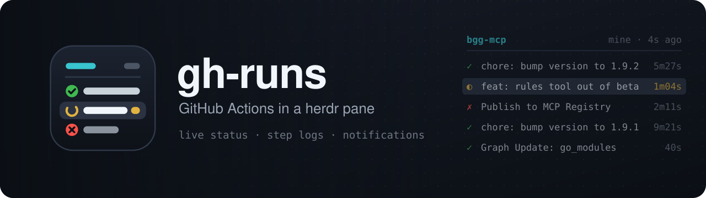
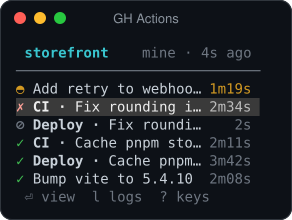
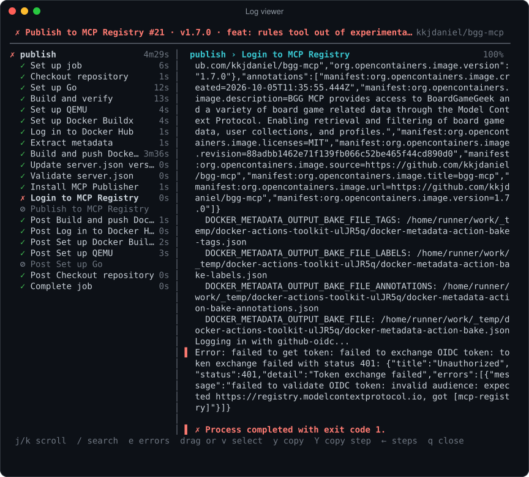

<p align="center">
  
</p>

<p align="center">
  A <a href="https://herdr.dev">herdr</a> plugin that keeps your GitHub Actions runs in a small pane beside your work,<br>
  and opens their logs in a viewer built for the terminal.
</p>

<p align="center">
  <code>herdr plugin install kkjdaniel/herdr-gh-runs</code>
</p>

---



## What it does

- **Shows the runs you triggered**, using the account you're logged in to with `gh`.
- **Follows the repo you're working in.** It reads the repo from whichever pane you
  have focused, including remotes that use SSH host aliases like `git@github-work:org/repo.git`.
- **Live status.** Running runs show a spinner and a ticking timer; finished runs show
  how long they took.
- **Docks under [herdr-sidebar](https://github.com/alexarthurs/herdr-sidebar)** as a
  small pane when you use it, and keeps your focus where it is.
- **Notifies you** through herdr when one of your runs finishes.
- **Watch, rerun or cancel** runs, or open them on GitHub.
- **Log viewer** with jobs and steps, clean logs, error jumping, search and copy.

<br clear="right">

## Log viewer

<p align="center">
  
</p>

Press `l` (or `Enter` on a finished run) to open it in a herdr popup.

- Jobs and steps on the left with their status and duration; the selected step's log on the right.
- Runner timestamps stripped, colours rendered, `##[group]` sections shown as headings and error lines marked in red.
- Failed runs open on the failed step, scrolled to the end where the error usually is.
- Drag to select text (it's copied when you let go), or press `Y` to copy the whole step's log, ready to paste into an agent.

## Requirements

- [herdr](https://herdr.dev) 0.9 or newer
- [GitHub CLI](https://cli.github.com) (`gh`), logged in with `gh auth login`
- Python 3.8 or newer (standard library only)
- macOS or Linux

## Install

```bash
herdr plugin install kkjdaniel/herdr-gh-runs
```

Then bind a key to open it. Add this to `~/.config/herdr/config.toml`:

```toml
[[keys.command]]
key = "prefix+g"
type = "plugin_action"
command = "kkjdaniel.gh-runs.toggle"
description = "GH Actions"
```

and reload with `herdr server reload-config`. You can also run the action directly:

```bash
herdr plugin action invoke kkjdaniel.gh-runs.toggle
```

The toggle opens the pane (under herdr-sidebar if the tab has one, otherwise beside the
focused pane), focuses it if it's already open, and closes it if it's focused.

To update later: `herdr plugin update kkjdaniel.gh-runs`.

## Keys

### Runs pane

| Key | Action |
| --- | --- |
| `↑` `↓` / `j` `k` | move |
| `Enter` | watch a running run, or open a finished one in the log viewer |
| `l` | log viewer, opened on the failed step |
| `o` | open the run on GitHub |
| `R` | rerun (only the failed jobs if it failed), asks first |
| `x` | cancel a running run, asks first |
| `a` | your runs / everyone's runs |
| `s` | this repo / all your recently active repos |
| `p` | pin the current repo instead of following focus |
| `r` | refresh now |
| `?` | key list |
| `q` | quit |

The header shows the repo, the filter (`mine` or `all`) and how long ago the list was refreshed.

### Log viewer

| Key | Action |
| --- | --- |
| `j` `k` | select a step (left), scroll (right) |
| `Enter` / `→` / `Tab` | move to the log; `←` / `Esc` / `Tab` go back |
| `e` / `E` | next failed step (left); next / previous error line (right) |
| `space` `b`, `^d` `^u`, `g` `G` | page, half page, top / bottom |
| `/` `n` `N` | search the selected step |
| `J` `K` | next / previous step without leaving the log |
| drag | select text; copied when you let go |
| `v` then `j` `k`, `y` | select whole lines from the keyboard, then copy |
| `Y` | copy the whole step's log |
| click, wheel | pick a step, scroll |
| `o` | open the selected job on GitHub |
| `r` | reload |
| `q` | close |

Selecting a job row shows that job's whole log. GitHub only publishes a job's log once
the job finishes; until then, `Enter` on the run opens the live `gh run watch` view.

## How it works

Everything goes through `gh`, so it uses whichever account `gh auth status` shows as
active. To see a repo that only another of your accounts can access, switch with
`gh auth switch`.

- **This repo:** the runs for the focused pane's repo, filtered to you with the `actor`
  query parameter. Refreshes every 10s while a run is active and every 30s otherwise.
- **All repos (`s`):** up to 12 repos you've recently pushed to or opened pull requests on,
  refreshed every 30s or 90s. Both modes stay well inside GitHub's API rate limit.
- **Log viewer:** fetches each job's log from the Actions API and splits it into steps
  using the step headers and start times.
- Copies use `pbcopy`, `wl-copy`, `xclip` or `xsel`, falling back to the terminal
  clipboard (OSC 52).

## Configuration

These are environment variables read by herdr's server process:

| Variable | Default | Effect |
| --- | --- | --- |
| `GH_RUNS_ROWS` | `14` | height of the pane when docked under herdr-sidebar |
| `GH_RUNS_REPO` | | start pinned to `owner/name` instead of following focus |

## Troubleshooting

- **The pane or popup closes suddenly.** The traceback is saved to `crash.log` in the
  plugin's state directory (`~/.local/state/herdr/plugins/kkjdaniel.gh-runs/` by default).
  Please include it in an issue.
- **"Not found" errors for a repo.** The active `gh` account can't see it; check
  `gh auth status`.
- **Action logs:** `herdr plugin log list --plugin kkjdaniel.gh-runs`.

## Development

```bash
git clone https://github.com/kkjdaniel/herdr-gh-runs
herdr plugin link "$PWD/herdr-gh-runs"
```

A linked plugin runs straight from your checkout. Close and reopen the pane to pick up
changes; the log viewer reloads with every popup.

## License

[MIT](LICENSE)
